<p align="center">
  <picture>
    <source media="(prefers-color-scheme: dark)" srcset="docs/readme/banner-dark.svg">
    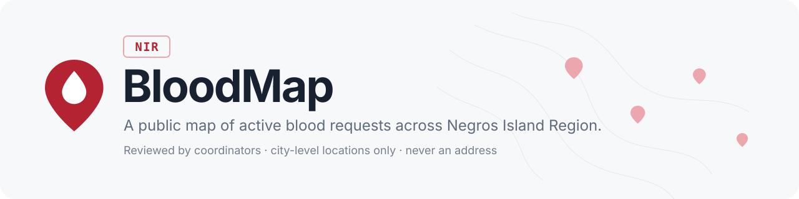
  </picture>
</p>

<p align="center">
  <a href="https://github.com/fhiejdaleplacer14-droid/BloodMap/actions/workflows/ci.yml"></a>
  
  
  
  
</p>

<p align="center">
  <a href="#screenshots">Screenshots</a> ·
  <a href="#local-setup">Run it locally</a> ·
  <a href="#demo-accounts">Demo accounts</a> ·
  <a href="docs/decisions.md">Design decisions</a>
</p>

---

BloodMap is a public map of active blood requests across Negros Island
Region. Facility desks post requests, coordinators review each one before it
goes public, and anyone can see where help is needed, without an address or a
private phone number ever reaching the map.

> [!NOTE]
> This is a portfolio project. All seeded requests, people and facilities are
> fictional and are labelled as demo data in the UI.

## Highlights

- **Find a request in seconds.** Filter by blood type, status, posting date
  and area, on a list or a live map, on desktop or phone.
- **Private by design.** Requests are placed at the municipality centroid,
  never at an address or a facility's coordinates. Desk contacts are gated by
  role, coordinators see them masked until they choose to reveal them, and
  every reveal is audited.
- **Reviewed before it's public.** Coordinators approve requests, send them
  back for correction or reject them, helped by automated checks for phone
  numbers, personal names, duplicates and missing desk hours.
- **A built-in guide.** It answers "how does this work?" questions from
  approved help articles and cites its source. It never gives medical advice
  or eligibility assessments: those questions get a fixed reply and never
  reach a model. It runs on Google's free Gemini tier, falls back to the plain
  help articles if that is unavailable, and works with no API key at all.
- **An audit trail that can't be edited.** `audit_logs` is insert-only: a
  database trigger rejects every UPDATE and DELETE.
- **Accessible.** Every screen, for every role, is scanned against WCAG 2.2
  AA in light and dark mode on every push.

### Who uses it

| Role | What they can do |
|------|------------------|
| **Visitor** | Browse and filter requests, open the details, ask the guide. No account needed. |
| **Donor** | Save requests, get notified when one changes, see desk contacts after signing in, report a problem with a listing, and opt in to a weekly summary email. |
| **Facility submitter** | Post requests through a guided wizard, fix requests sent back for correction, and close them when fulfilled. |
| **Coordinator** | Work a regional review queue, approve or send back requests, triage reported listings, and reveal contacts (audited). |
| **Administrator** | Invite coordinators by email, manage users and coverage, read the audit log and platform metrics, and edit system settings (audited). |

## Screenshots

<table>
  <tr>
    <td width="50%">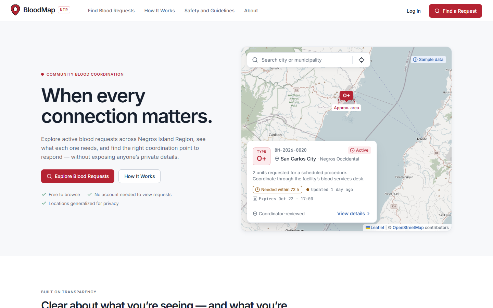</td>
    <td width="50%">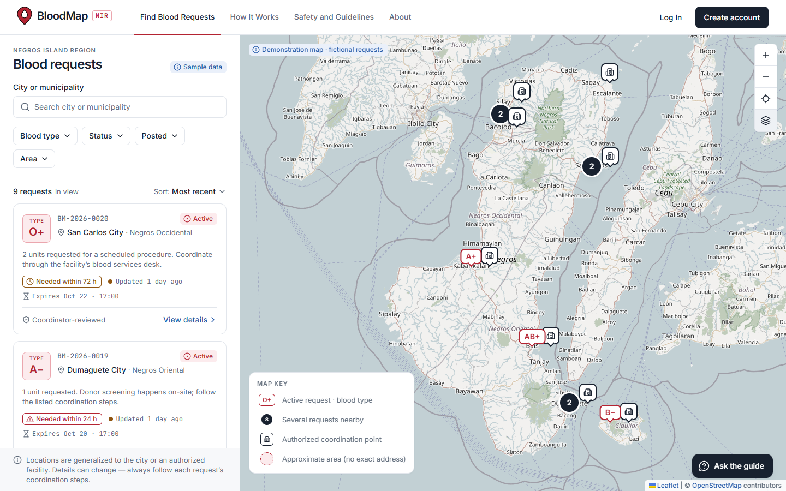</td>
  </tr>
  <tr>
    <td align="center"><b>Landing</b></td>
    <td align="center"><b>Explorer</b>: list and map, with filters</td>
  </tr>
  <tr>
    <td>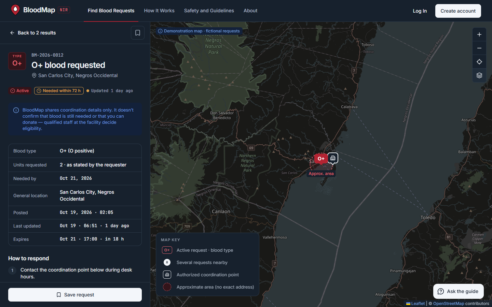</td>
    <td>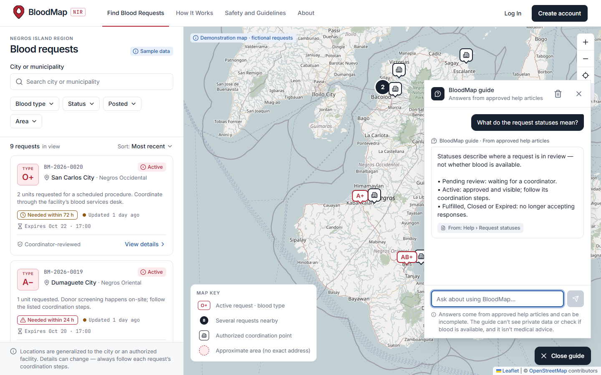</td>
  </tr>
  <tr>
    <td align="center"><b>Request details</b> (dark mode)</td>
    <td align="center"><b>The guide</b>: answers cite their help article</td>
  </tr>
  <tr>
    <td>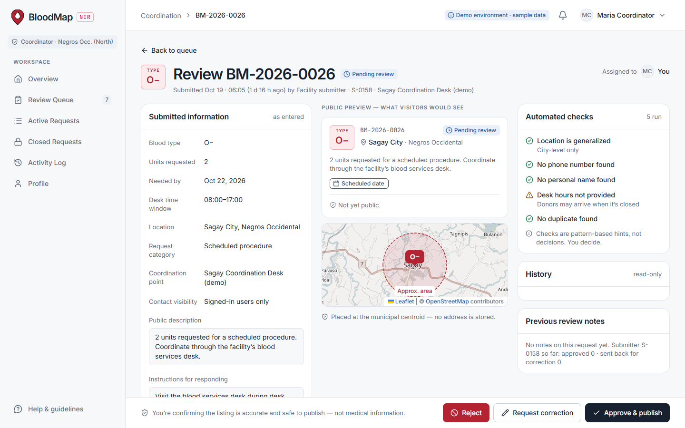</td>
    <td>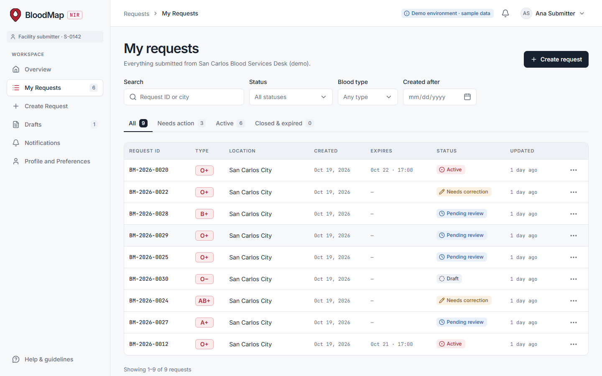</td>
  </tr>
  <tr>
    <td align="center"><b>Coordinator review</b> with automated checks</td>
    <td align="center"><b>Facility desk</b>: my requests</td>
  </tr>
  <tr>
    <td>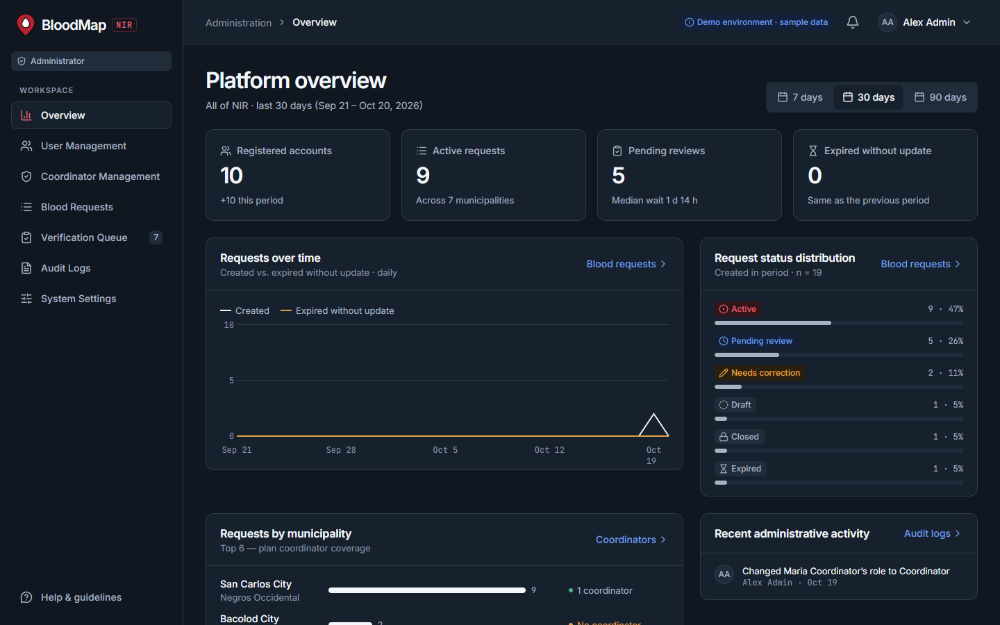</td>
    <td>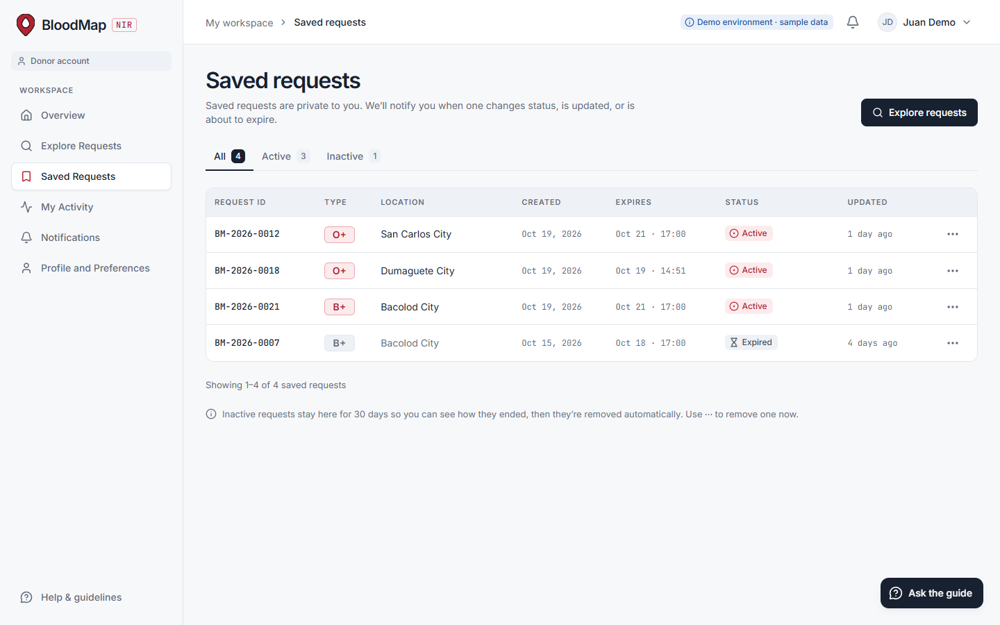</td>
  </tr>
  <tr>
    <td align="center"><b>Admin overview</b> (dark mode)</td>
    <td align="center"><b>Donor</b>: saved requests</td>
  </tr>
</table>

### On a phone

<table>
  <tr>
    <td width="33%">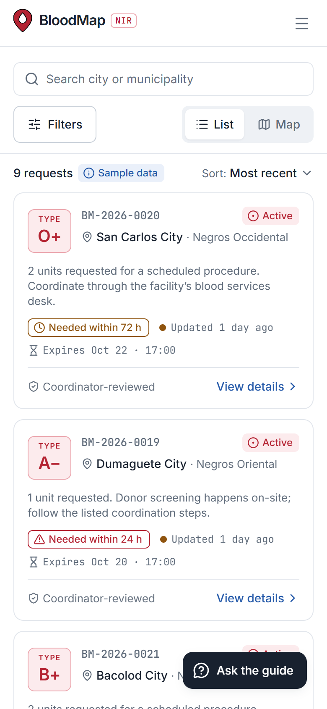</td>
    <td width="33%">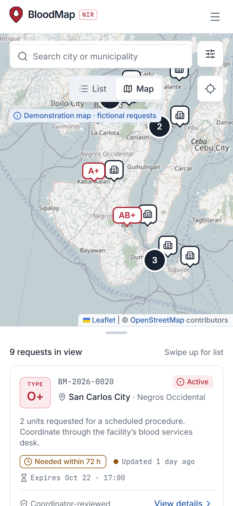</td>
    <td width="33%">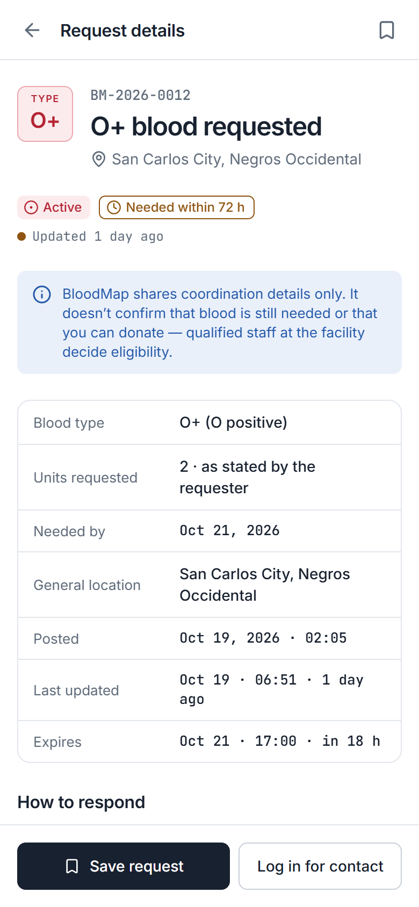</td>
  </tr>
  <tr>
    <td align="center">List</td>
    <td align="center">Map and sheet</td>
    <td align="center">Details</td>
  </tr>
</table>

## Stack

| Layer      | Choice |
|------------|--------|
| Frontend   | React · TypeScript · Vite · Tailwind CSS · TanStack Query · React Router · Radix (`/frontend`) |
| Backend    | Laravel REST API · Sanctum SPA cookie auth (`/backend`) |
| Database   | PostgreSQL. Local via Docker Compose, configured only through `DB_*` env vars |
| Maps       | Leaflet + OpenStreetMap (attribution always visible) |
| Testing    | PHPUnit · Playwright · axe-core (WCAG 2.2 AA) |
| CI         | GitHub Actions (`.github/workflows/ci.yml`) |

## Repository layout

```
.
├── backend/                 Laravel API
├── frontend/                React SPA
├── docs/                    Design decisions and README assets
├── docker/postgres/init/    First-start scripts for the local Postgres container
├── docker-compose.yml       Local PostgreSQL 17
├── .env.example             Values docker-compose reads (copy to .env)
└── .github/workflows/ci.yml
```

## Prerequisites

- Docker (for the local database)
- PHP 8.2+ with the `pdo_pgsql` extension enabled, and Composer
- Node.js 24 (see `frontend/.nvmrc`) and npm

## Local setup

```bash
# 1. Database
cp .env.example .env
docker compose up -d            # PostgreSQL on localhost:5432 (+ bloodmap_testing DB)

# 2. API  → http://localhost:8000
cd backend
composer install
cp .env.example .env
php artisan key:generate
# optional: set ASSISTANT_DRIVER=gemini and GEMINI_API_KEY in .env for the AI guide
php artisan migrate --seed      # NIR geography + fictional demo data
php artisan serve
php artisan queue:work          # second terminal: emails & automated checks
php artisan schedule:work       # third terminal: expiry every 5 min, reminders, weekly summary

# 3. SPA  → http://localhost:5173
cd frontend
npm ci
cp .env.example .env.local
npm run dev
```

Re-run `php artisan migrate:fresh --seed` at any time to reset the demo.
Seed dates are relative to now, so the demo always has live requests. In
development, emails go to `storage/logs/laravel.log` (`MAIL_MAILER=log`).

### Demo accounts

All demo records are fictional and carry `is_demo = true`. Every account
uses the password in `DEMO_PASSWORD`.

| Email | Role | Notes |
|-------|------|-------|
| `juan.demo@example.org` | Donor | Has saved requests, one of them expired |
| `ana.desk@example.org` | Facility submitter `S-0142` | San Carlos Blood Services Desk (demo) |
| `m.coord@example.org` | Coordinator | Negros Occidental (North) review queue |
| `lina.t@example.org` | Coordinator | Negros Oriental |
| `admin@example.org` | Administrator | |
| `admin2@example.org` | Administrator | Second admin for promotions to Administrator |

## API

Sanctum SPA cookie auth: the SPA calls `GET /sanctum/csrf-cookie`, then
`POST /login`. Every other endpoint lives under `/api`. Run
`php artisan route:list --except-vendor` for the full list. The contracts
follow Figma's *Handoff · API & data* frame plus `docs/decisions.md`.

- Policies decide every action; resources decide every field.
- Public responses carry the municipality centroid only, never an address
  or a facility's coordinates.
- The desk contact is gated by `contact_visible_to`. Coordinators see it
  masked until they reveal it, and each reveal is audited.
- `audit_logs` is insert-only: a database trigger rejects UPDATE and DELETE.
